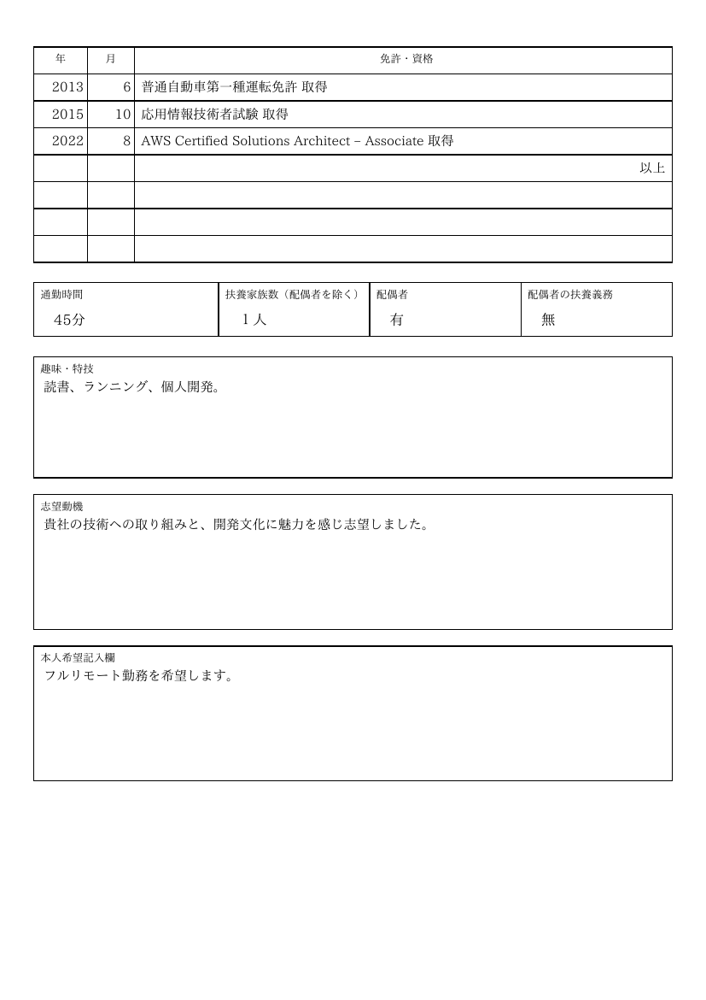

# career

<!-- ALL-CONTRIBUTORS-BADGE:START - Do not remove or modify this section -->
[](#contributors-)
<!-- ALL-CONTRIBUTORS-BADGE:END -->
[](https://github.com/nao1215/career/actions/workflows/unit_test.yml)
[](https://github.com/nao1215/career/actions/workflows/build.yml)
[](https://github.com/nao1215/career/actions/workflows/e2e_test.yml)

[](https://github.com/nao1215/career/actions/workflows/gitleaks.yml)
[](https://github.com/nao1215/career/actions/workflows/trivy.yml)
[](https://github.com/nao1215/career/actions/workflows/govulncheck.yml)
[](https://github.com/nao1215/career/actions/workflows/gosec.yml)
[](https://github.com/nao1215/career/actions/workflows/reviewdog.yml)
[](https://github.com/nao1215/atago)
[](https://github.com/nao1215/himorime)
[](https://github.com/nao1215/career/releases)
[](./LICENSE)
[](https://scorecard.dev/viewer/?uri=github.com/nao1215/career)

career renders résumé PDFs from one YAML file: a Japanese 履歴書 (rirekisho), a 職務経歴書 (work history), and an English CV. Text fields can hold Japanese and English, so one file you keep in Git backs all three.


## What it produces

The previews are rendered from [`examples/resume.yaml`](./examples/resume.yaml). Click one to open its sample PDF.

| cv (English résumé) | work-history (職務経歴書) |
| :---: | :---: |
| [](./image/cv-sample.pdf) | [](./image/work-history-sample.pdf) |

| japanese-resume (履歴書) page 1 | page 2 |
| :---: | :---: |
| [](./image/japanese-resume-sample.pdf) |  |

## Example

```yaml
# resume.yaml
profile:
  name:
    ja: 見本 太郎
    en: Taro Mihon
  email: taro.mihon@example.com
career:
  summary:
    ja: バックエンドとクラウドを中心に約10年。
    en: About 10 years across backend and cloud.
  skills:
    - { ja: Go によるサーバーサイド開発, en: Backend development in Go }
```

```bash
career generate resume.yaml -t cv               -o cv.pdf
career generate resume.yaml -t japanese-resume  -o rirekisho.pdf
career generate resume.yaml -t work-history     -o shokumukeirekisho.pdf
```

## Install

### Use "go install"

```bash
go install github.com/nao1215/career@latest
```

Building from source needs Go 1.23.12 or newer.

### Install from a package or binary

[The release page](https://github.com/nao1215/career/releases) has `.deb`,
`.rpm`, and `.apk` packages for `amd64` and `arm64`, plus `.tar.gz` archives for
Linux and macOS and `.zip` archives for Windows.

```shell
# Debian, Ubuntu
sudo dpkg -i career_0.3.0_linux_amd64.deb

# Fedora, RHEL, openSUSE
sudo rpm -Uvh career_0.3.0_linux_amd64.rpm

# Alpine Linux
sudo apk add --allow-untrusted career_0.3.0_linux_amd64.apk
```

Replace `0.3.0` with the release you downloaded and `amd64` with `arm64` where
applicable.

### Verifying release integrity

Releases after v0.2.5 include `checksums.txt` signed keyless with [cosign](https://github.com/sigstore/cosign) (`checksums.txt.sigstore.json`), an SPDX SBOM (`*.sbom.json`) per archive, and SLSA build provenance attested through GitHub OIDC and attached as `multiple.intoto.jsonl`.

Verify the signed checksums, then your download:

```shell
cosign verify-blob \
  --bundle checksums.txt.sigstore.json \
  --certificate-identity-regexp 'https://github.com/nao1215/career/\.github/workflows/release\.yml@refs/tags/.*' \
  --certificate-oidc-issuer 'https://token.actions.githubusercontent.com' \
  checksums.txt
sha256sum --check --ignore-missing checksums.txt
```

Verify the build provenance with the GitHub CLI:

```shell
gh attestation verify career_<version>_<os>_<arch>.tar.gz --repo nao1215/career
```

Or verify the archive against `multiple.intoto.jsonl` with [slsa-verifier](https://github.com/slsa-framework/slsa-verifier):

```shell
slsa-verifier verify-artifact career_<version>_<os>_<arch>.tar.gz \
  --provenance-path multiple.intoto.jsonl \
  --source-uri github.com/nao1215/career \
  --source-tag v<version>
```

### Build from source

```bash
git clone https://github.com/nao1215/career.git
cd career
make build   # produces ./career
```

## Usage

`career init` writes a starter `resume.yaml`.

| Command | Description |
| :--- | :--- |
| `career init [PATH]` | Write a starter resume YAML file (`--force` to overwrite) |
| `career generate` | Render a resume YAML file into one or more PDFs |
| `career templates` | List the available templates |
| `career version` | Print the version |
| `career help [command]` | Show help |

`generate` takes the input file as the first argument or `--input`, the template
as `--template`/`-t`, the output as `--output`/`-o`, an accent color as
`--accent`, and a portrait as `--photo`.

With no `--template`, `generate` renders `cv`. To render several, repeat
`--template`, comma-separate names, or pass `all`. Each goes to its default file
name, so `--output` works only with a single template.

```bash
career generate resume.yaml                  # cv.pdf
career generate resume.yaml -t all           # cv.pdf, japanese-resume.pdf, work-history.pdf
career generate resume.yaml -t cv,work-history
```

## Sections per template

Each template reads only the sections it needs:

| Section | cv | japanese-resume | work-history |
| :--- | :---: | :---: | :---: |
| `profile` | ✓ | ✓ | ✓ |
| `education` | ✓ | ✓ | |
| `work` / `licenses` | | ✓ | |
| `rireki` (hobby, motivation, …) | | ✓ | |
| `career` (summary, skills, history, …) | ✓ | | ✓ |

### Multilingual fields

A text field is either a plain scalar, used for every language, or a
`{ ja:, en: }` map as in the example above. `cv` reads `en` and the Japanese
templates read `ja`. Each falls back to whatever is present, so a
single-language file works with every template.

### Line breaks in text

The renderer re-flows wrapped lines to the page width, joining Japanese lines
with no space and Latin words with one space. A blank line starts a new
paragraph and stays as vertical space. A line that begins with a bullet (`・`,
`-`, `*`, `•`) stays on its own line, which suits the 履歴書 hobby, motivation,
and request boxes.

```yaml
career:
  summary:
    ja: |
      組み込みソフトウェア開発からキャリアを始め、サーバーサイド開発を経て、
      現在はバックエンド開発とエンジニアリングマネジメントを担当しています。

      要件定義からテストまでの全工程と、外注管理・採用・教育の経験があります。
```

## Templates

Long histories flow onto additional pages.

| Template | Aliases | Document |
| :--- | :--- | :--- |
| `cv` | | English résumé: contact header, Summary, Skills, Experience, Education, Certifications, Publications. |
| `japanese-resume` | `履歴書` | JIS-style 履歴書 on A4: photo frame, personal block, and the 学歴・職歴 / 免許・資格 tables. Always black, per the form's convention. |
| `work-history` | `職務経歴書`, `career-history` | Japanese 職務経歴書: 職務要約, skills, per-company project history, 資格, 出版, 自己PR. |

## Photo (履歴書)

Only `japanese-resume` has a photo frame (the JIS 3:4, 30×40mm box). Set it in
YAML or on the command line:

```yaml
profile:
  photo: face.jpg   # JPEG or PNG; resolved relative to this YAML file
```

```bash
career generate resume.yaml -t japanese-resume --photo face.jpg
```

`--photo` overrides `profile.photo` and is resolved relative to the current
directory. The image keeps its proportions: a non-3:4 image is centered with
margins and a warning suggests cropping, and a missing file falls back to the
placeholder. The preview uses
[`image/sample_japanese_man.jpg`](./image/sample_japanese_man.jpg), a portrait
of a fictional person.

## Accent color

`cv` and `work-history` use one accent color for headings. `japanese-resume`
ignores it and stays black.

```yaml
theme:
  accent: "#1f4e79"   # "" = default, "none" = monochrome, or any #rrggbb
```

```bash
career generate resume.yaml -t cv --accent none   # monochrome
```

## Development

```bash
make tools     # install golangci-lint, octocov, atago
make test      # unit tests with coverage
make lint      # golangci-lint
make e2e       # atago end-to-end tests against a freshly built binary
make build     # build ./career
make demo      # regenerate image/demo.gif (needs vhs)
```

## Testing

| Technique | Bug class caught here |
|---|---|
| [Unit tests](docs/testing.md#unit-tests) | Wrong validation, layout and rendered pages |
| [Generated properties](docs/testing.md#generated-properties) | Text that resolves to the wrong language |
| [Metamorphic relations](docs/testing.md#metamorphic-relations) | Line breaking that depends on the column width or paragraph order |
| [Fuzzing](docs/testing.md#fuzzing) | Panics and lost text on malformed YAML and free text |
| [CLI end-to-end tests](docs/testing.md#cli-end-to-end-tests) | Wrong exit codes, flags and written files of the binary |
| [Output snapshots](docs/testing.md#output-snapshots) | Unintended changes to the help and template listing |
| [Mutation testing](docs/testing.md#mutation-testing) | Tests that still pass when a comparison or branch is changed |
| [Paired CI benchmarks](docs/testing.md#paired-ci-benchmarks) | Slower generation hidden by runner noise |

## Contributors ✨

Thanks goes to these wonderful people ([emoji key](https://allcontributors.org/en/reference/emoji-key/)):

<!-- ALL-CONTRIBUTORS-LIST:START - Do not remove or modify this section -->
<!-- prettier-ignore-start -->
<!-- markdownlint-disable -->
<table>
  <tbody>
    <tr>
      <td align="center" valign="top" width="14.28%"><a href="https://debimate.jp/"><br /><sub><b>CHIKAMATSU Naohiro</b></sub></a><br /><a href="https://github.com/nao1215/career/commits?author=nao1215" title="Code">💻</a> <a href="https://github.com/nao1215/career/commits?author=nao1215" title="Documentation">📖</a></td>
    </tr>
  </tbody>
</table>

<!-- markdownlint-restore -->
<!-- prettier-ignore-end -->

<!-- ALL-CONTRIBUTORS-LIST:END -->

This project follows the [all-contributors](https://github.com/all-contributors/all-contributors) specification. Contributions of any kind welcome!

## Fonts and license

career embeds the [IPAex fonts](https://moji.or.jp/ipafont/) (IPAex Mincho and
IPAex Gothic), distributed under the IPA Font License Agreement v1.0. The license
ships with the fonts under
[`internal/font/assets`](./internal/font/assets).

The career source code is released under the [MIT License](./LICENSE).
